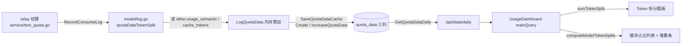

# TECH.md — 用量分析页的模型 Token 缓存拆分

用户可见行为以 [PRODUCT.md](./PRODUCT.md) 为准，本文只记录实现方案、边界与验证。

## 上下文

### 后端现状

用量分析页唯一数据源是 `GET /api/data/daily`（`controller/usedata.go:85-127`），它查询 `quota_data`
表，按天（可选按模型）求和 `count / quota / token_used`（`model/usedata.go:174-190` 的 `GetQuotaDataDaily`）。
该表没有任何输入/输出/缓存拆分列。

`quota_data` 有两条累加路径，都必须覆盖新列：

- 内存合并：`LogQuotaData`（`model/usedata.go:78`）→ `logQuotaDataCache`（`model/usedata.go:54`）；
- 落库：`SaveQuotaDataCache`（`model/usedata.go:100`）对已存在的行走 `increaseQuotaData`
  （`model/usedata.go:127`）的增量 `UPDATE`，否则 `Create`。

写入方有两处：`RecordConsumeLog`（`model/log.go:402-419`，文本/音频/实时语音等消耗）与
`RecordTaskBillingLog`（`model/log.go:466-482`，任务类计费，本身没有 prompt/completion token）。
`&QuotaData{}` 已在 `model/main.go:359` 的 `AutoMigrate` 列表里，加列不需要手写迁移。

### 语义分叉（本需求的关键）

`prompt_tokens` 是否包含缓存读取决于 usage 语义，判定逻辑见 `service/text_quota.go:96-114`
（`usageDashboardTokenUsed`）：anthropic 语义与 legacy claude 派生口径下 `prompt_tokens` 是不含缓存的
剩余量，总量要补上缓存两项；其余口径下 `prompt_tokens` 已含缓存命中，重复相加会双重计数。

日志的 `other` 里有两个现成标记，写在**同一行**上，可直接作为拆分依据：

- `other.usage_semantic = "anthropic"`：仅 anthropic 语义的行会写（`service/text_quota.go:504`）；
- `other.cache_tokens`：缓存读数量（`service/log_info_generate.go:106`，公开字段，`Snapshot()` 可取）。

因为拆分只在**写入时**算一次，升级前的历史行不带这些值，天然落到「无拆分数据」分支，不需要回填。

### 前端现状

`UsageDashboard`（`web/src/features/dashboard/components/usage/usage-dashboard.tsx:57`）持有时间范围与
指标两个全局状态，拉 `mainQuery`（`with_models=true`）与 `yearQuery` 两路数据，派生
`summary / change / colorMap / series / topModels` 交给 `UsageSummaryCard`。柱形图图例已是
`selectMode: 'single'`（`usage-daily-chart.tsx:114`），但选中态没有对外暴露，父级无从得知。
右栏 300px 固定宽（`usage-summary-card.tsx:190`），下面是 grid。

## 建议的更改

### A. 后端（`model` 包内完成，不动接口层）

**A1. `QuotaData` 增加三列**（`model/usedata.go:13`）：

```go
UncachedInputTokens int `json:"uncached_input_tokens" gorm:"default:0"`
CacheReadTokens     int `json:"cache_read_tokens" gorm:"default:0"`
OutputTokens        int `json:"output_tokens" gorm:"default:0"`
```

随 `AutoMigrate` 加列；`controller/usedata.go` 不用改，JSON 自动多出三个字段（满足 PRODUCT 第 7 条）。

**A2. `QuotaDataLogParams` 增加同名字段**，`logQuotaDataCache` 与 `increaseQuotaData` 同步累加
（满足 PRODUCT 第 4 条：两条路径都加，漏一条就会在周期刷新后丢数）。

**A3. `RecordConsumeLog` 里推导三列并传给 `LogQuotaData`**，新增未导出函数：

```go
func quotaDataTokenSplit(other *LogOther, promptTokens int, completionTokens int) (int, int, int)
```

规则：`output = clamp(completionTokens)`；`cacheRead = clamp(other.cache_tokens)`；
`uncachedInput = clamp(promptTokens)`，当 `other.usage_semantic != "anthropic"` 时改为
`clamp(promptTokens - cacheRead)`；`clamp` 为 `[0, math.MaxInt32]`，与 `usageDashboardTokenUsed`
的饱和边界一致（满足 PRODUCT 第 2、3 条）。

放在 `model/log.go` 而不是 `service/text_quota.go` 的理由：三个消耗调用点（`RecordConsumeLog` 与
`service/quota.go:250`、`service/quota.go:389` 的音频/实时语音）因此零改动即可全部覆盖，且判定依据
（`usage_semantic`）就在同一行的 `other` 里，规则自解释。代价见「风险」第 2 条。

**A4. `GetQuotaDataDaily` 两个分支的 `selectCols` 各加三个 `sum(...)`**（`model/usedata.go:177,180`）。

**A5. `RecordTaskBillingLog` 不传三列**（保持 0），任务类计本来就没有 token 拆分（满足 PRODUCT 第 16
条对应的数据侧事实）。

### B. 前端

**B1. 类型**：`types.ts:176` 的 `DailyUsageItem` 增加三个可选数字字段
（`uncached_input_tokens?` / `cache_read_tokens?` / `output_tokens?`）。

**B2. 纯函数**（`lib/usage.ts`，导出到 `lib/index.ts`，全部可单测）：

- `sumTokenSplit(rows, model?)` → `{ uncachedInput, cacheRead, output, total, inputTotal, cacheHitRate, hasSplitData }`；
  `cacheHitRate` 为百分比数值，输入侧合计为 0 时返回 `null`；三项全 0 时 `hasSplitData = false`。
- `computeModelTokenSplits(rows, limit = USAGE_CACHE_MODEL_LIMIT)` → `{ entries, other }`：
  过滤掉 `hasSplitData = false` 的模型，按 `total` 降序、同值按模型名字典序，超出 `limit` 的合并为
  `other`（三列分别求和，命中率按合计重算，不是平均）。
- `USAGE_CACHE_MODEL_LIMIT = 20` 与三个语义色常量 `USAGE_TOKEN_SPLIT_COLORS`（取自仓库既有
  `lib/charts.ts:696` 的 `USER_COLORS`：缓存读 `#5AD8A6`、非缓存读 `#F6BD16`、输出 `#5B8FF9`）。

**B3. `usage-dashboard.tsx`**：新增 `selectedModel` state；`rangeDays` / `metric` 变化时复位为 `null`
（`useEffect`，满足 PRODUCT 第 14 条）；`useMemo` 派生 `tokenSplit` 与 `cacheSplits` 后下传。

**B4. `usage-daily-chart.tsx`**：新增 `selectedModel` 与 `onSelectedModelChange`，图例点击经
`onReady` 拿到的 vchart 实例绑定（`instance.on('legendItemClick', handler)`，每次 ready 前先
`off` 同一个 handler，保证同一实例上只有一个监听器）。选中态与回调用 ref 提供给稳定 handler，
避免图表实例因指标/主题切换重建或规格更新后读到过期 state。`legendItemClick` 的载荷是
`{ model, value: currentSelected }`（vchart `component/legend/discrete/legend.js:136`）：
单选模式下长度为 1 → 选中该模型；vchart 的单选图例**不会**自行取消选中（重复点击仍上报同一项），
因此同一模型再次传来时前端按取消选中处理，恢复 Top models 榜单。

**B5. `usage-top-models.tsx`**：每行包成 `<button>`，点击选中该模型。这是 PRODUCT 第 10 条要求的
键盘可达等价入口（vchart 图例项不可键盘聚焦），顺带让榜单行变成可探索的。

**B6. 两个新组件**（`usage/` 目录，测试放各自 `__tests__/`）：

- `usage-model-token-split.tsx`：props `{ model, split, metric, loading, error, onRetry, onBack }`；
  自己负责指标门（`metric !== 'tokens'` 时渲染提示文案，满足 PRODUCT 第 15 条），渲染三项数值 +
  百分比 + 100% 三段堆叠条 + 合计 + 输入侧缓存命中率 + 返回榜单按钮；`hasSplitData = false` 时
  渲染空状态（第 16 条）。
- `usage-model-cache-panel.tsx`：props `{ ranks, metric, loading, locale }`；同样自己负责
  指标门（`metric !== 'tokens'` 时返回 null，第 23 条），渲染列表 + 每行 100% 三段堆叠横条，
  两块在 `lg` 断点左右并排、窄屏堆叠。堆叠条用 `div + width%` 实现，沿用
  `usage-top-models.tsx:76-88` 的进度条写法，**不引入第二个 VChart 实例**；悬浮明细用 `title`
  属性（与 `usage-summary-card.tsx` 的 `TooltipFullValue` 一致）。图表块按第 19 条**不重复展示
  模型列**，行的归属由两块行序一致承载（2026-10-14 曾整块删除右侧图表，后按用户要求恢复，
  仅去掉模型列）。

**B7. `usage-summary-card.tsx`**：右栏按 `selectedModel !== null` 在 `UsageTopModels` 与
`UsageModelTokenSplit` 之间切换（`metric !== 'tokens'` 时后者自己渲染提示，第 15 条）；
grid 下方在 `metric === 'tokens'` 时渲染带卡片内边距的 `<UsageModelCachePanel>`（第 18 条）。

**B8. i18n**：`src/i18n/locales/en.json` 追加英文 key → `bun run i18n:sync` → 手工补齐
zh / zh-TW / fr / ru / ja / vi 六个语言。



## 测试和验证

编号对应 [PRODUCT.md](./PRODUCT.md) 的行为不变量。

### 后端（Go）

1. **累加不变量（第 4 条）**——在 `model/usedata_flow_test.go` 新增
   `TestLogQuotaDataAccumulatesTokenSplitOnBothFlushPaths`：同键两次 `LogQuotaData` +
   `SaveQuotaDataCache`（内存合并路径），再对已存在的行 `LogQuotaData` + `SaveQuotaDataCache`
   （`increaseQuotaData` 增量路径），断言三列与 `Count` 一样按次数累加。不新增测试文件。
2. **接口契约（第 7、8 条）**——扩展 `controller/usedata_test.go:88` `TestGetDailyQuotaDatesSuccess`：
   插入带三列的 `QuotaData`，断言响应 JSON 含三个字段与正确的按天/按模型求和，既有字段不变。
3. **口径（第 2、3 条）**——在 `model/usedata_flow_test.go` 同文件补 `quotaDataTokenSplit` 表驱动用例：
   anthropic 标记不减缓存、无标记减缓存、无 `other`、负值与超 `MaxInt32` 钳制、输出原样透出。
4. **三库真实实例验证（AGENTS.md 强制）**——已执行部分：
   - **SQLite 3.50.4**（文件库，反复开关）：造出升级前无三列的 `quota_data` 与一行历史数据 →
     `AutoMigrate(&QuotaData{})` 两次（幂等）→ 存量行三列读回为 0（无 scan 错误）→
     `LogQuotaData` × 3 + `SaveQuotaDataCache` × 2（覆盖两条累加路径）→
     `GetQuotaDataDaily` 返回三列正确求和、存量行贡献 0。新列 DDL：`INTEGER DEFAULT 0`。
   - **PostgreSQL 18.4**（Docker 真实实例）：同一套流程全部通过；新列 DDL：`bigint DEFAULT 0`，
     存量行同样读回 0，二次迁移无变化。
   - **MySQL ≥ 5.7.8：未执行**——本机没有 MySQL 镜像且连不上 Docker Hub（拉取超时），也没有本地
     mysqld。因此本次变更**未取得 MySQL 的实证**，不得声称三库全部验证通过。MySQL 侧需要补跑：
     准备一个 MySQL 实例后设 `TEST_MYSQL_DSN`，对升级前库执行一次启动迁移并检查
     `quota_data` 三列默认值与既有行读回值。

### 前端（Vitest + React Testing Library）

5. **聚合逻辑（第 19、20 条）**——扩展 `lib/__tests__/usage.test.ts`：`sumTokenSplit` 的合计/命中率/
   全 0 判定；`computeModelTokenSplits` 的降序、同值字典序、全 0 模型过滤、topN + 其他合并、
   其他行命中率按合计重算。
6. **拆分面板（第 11、12、15、16 条）**——新增
   `usage/__tests__/usage-model-token-split.test.tsx`：三项数值与百分比相加为 100%、命中率在输入为 0
   时显示占位符、`metric !== 'tokens'` 显示提示、全 0 显示空状态、点击返回榜单触发 `onBack`。
7. **缓存占比面板（第 19、20、22、23 条）**——新增
   `usage/__tests__/usage-model-cache-panel.test.tsx`：列表行数与顺序、100% 堆叠条三段宽度、
   其他行合计、空状态文案、`metric !== 'tokens'` 不渲染。
8. **选中入口（第 10 条）**——扩展 `usage-daily-chart.test.tsx`：mock 的 VChart 捕获
   `onLegendItemClick`，触发后断言回调传出模型名与 `null`；扩展 `usage-top-models.test.tsx`：
   行按钮点击回调与键盘可聚焦。

### 手动与工具链

9. `bun run dev` 起前后端，管理员登录 `/dashboard/usage`：点击图例与榜单行选中模型，核对三项数值与
   同期 `logs` 明细量级一致；切换指标/时间范围确认面板复位与隐藏；截图留证。
10. **真实浏览器手工验证**（本地临时 SQLite 库 + `bun run dev`，管理员登录
    `/dashboard/usage`）：页面正常渲染；「模型缓存占比」列表与堆叠条数值、命中率正确（与播种
    数据一致）；点击 Top models 行后「Token 拆分」面板数值与占比正确；切换指标后面板按预期
    隐藏并给提示。
    ⚠️ **未能在沙箱里完成图例点击的端到端验证**：canvas 图例的点击坐标不稳定，且页面数据加载
    在反复热更新后失效。已单独确认的事实：`onReady` 会触发、vchart 图例确实会派发
    `legendItemClick`（在实例上挂监听器能收到）、`instance.on/off` 可用。合入后请人工点一次
    柱形图图例确认面板联动。
11. `bun run typecheck`、`bun run lint`（只修涉及文件）、`bun run test`（涉及测试文件）、
    `bun run i18n:sync` 后用 `git diff --stat` 确认只有预期文件变化。
    **不要跑 `bun run format`**——它会重写全仓文件。

## 风险和缓解

1. **存量行三列为 NULL 会让整个页面 500**：若 `AutoMigrate` 加列时没带 `DEFAULT 0`，既有行是 NULL，
   GORM 扫进 `int` 字段会直接报错，`/api/data/daily` 全挂。**已在 SQLite 与 PostgreSQL 上实测排除**：
   GORM 为三列发出的 DDL 都带 `DEFAULT 0`，存量行读回为 0。MySQL 未实测，见「测试和验证」第 4 条。
2. **legacy claude 派生口径与 `usage_semantic` 不完全重合**：`isLegacyClaudeDerivedOpenAIUsage`
   （`service/text_quota.go:116`）也判定「prompt 不含缓存」，但不会写 `usage_semantic`，会被当成
   「已含缓存」而多减一次。此类行的 `cache_tokens` 实际为 0（缓存信息在 claude 专用字段），
   `prompt - 0` 无影响；在 `quotaDataTokenSplit` 注释里写明这个已知边界。
3. **`DataExportEnabled` 关闭时无数据**：与柱状图同源，不引入新故障模式。
4. **性能**：每行多 12 字节、聚合 SQL 多三个 `SUM`，`quota_data` 上 `token_used` 与
   `(model_name, created_at)` 索引不变，可忽略。
5. **图表重建与选中态竞态**：`UsageDailyChart` 的 `key` 含 `series.length`，切换时间范围会重建实例；
   父级在同一 effect 里复位 `selectedModel`，不会展示上一个范围的拆分。

## 后续工作

- 缓存写（`cache_creation_tokens`）本期不做；若后续要补，`quota_data` 需再加一列，前端拆分面板与占比
  面板各加一段，接口无需变化。
- 输入侧命中率与「三项合计占比」两个口径目前只用前者；若产品后续要同时展示，`sumTokenSplit` 已具备
  计算两者的全部输入，不需要改数据层。
