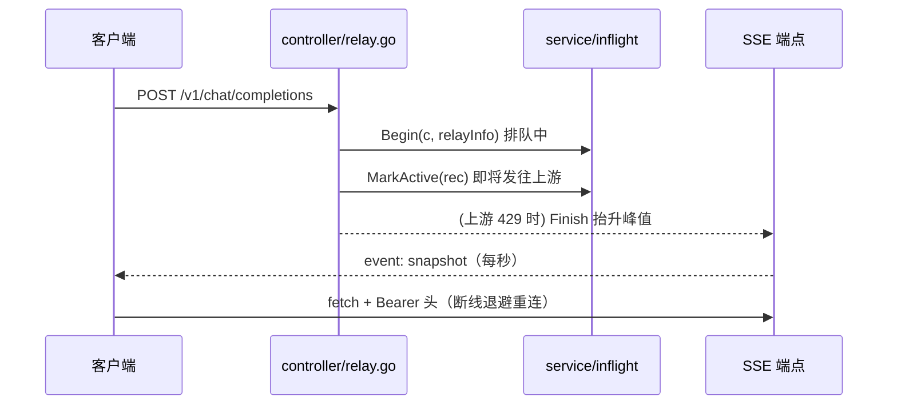

# TECH.md — 实时在途请求监控

用户可见行为以 [PRODUCT.md](./PRODUCT.md) 为准。本文记录实现方案、边界与验证。

## 上下文

### 现状

- 所有 relay 请求都经过 `controller/relay.go:69` 的 `Relay(c, relayFormat)`：入口 →
  `GenRelayInfo`（拿到 `relayInfo`，含 `OriginModelName`）→ `PrepareRequestBilling` →
  重试循环（`getChannel` 选路 → `PrepareTieredBillingForSelectedGroup` → 按格式分发到
  `relayHandler` / `relay.ClaudeHelper` / `geminiRelayHandler` / `relay.WssHelper` 发往上游）。
- 错误统一收敛到函数顶部的 `newAPIError`（`*types.NewAPIError`，带 `StatusCode`），由第一个 `defer`
  写出响应；panic 由第二个 `defer` 转成 error 后重新 panic。
- 预计读取 token 的口径沿用 `relayInfo.GetEstimatePromptTokens()`（预扣费同源），不新造估算。
- 项目内**没有**任何在途请求注册表，也**没有** SSE / WebSocket 基础设施；前端实时面板的既有先例是
  轮询（`system-instances-panel.tsx` 的 `refetchInterval`、`inference-status-dialog` 的 5 秒）。
- 控制台接口鉴权只认 `Authorization: Bearer` 头（`middleware/auth.go:206` 的
  `classifyDashboardCredential`），**不读 cookie**——浏览器原生 `EventSource` 无法带自定义头，
  因此前端用 `fetch` + 流式读取自己解析 SSE 帧。

### Fork 合并友好性（本设计的一级约束）

用户是开源仓库的 fork，要求新功能**不要和现有代码纠缠**。因此：

- 新增逻辑全部放在新文件 / 新包里，`service/inflight/`（后端）、
  `web/src/features/dashboard/lib/inflight*.ts` 与 `components/usage/usage-inflight-panel.tsx`（前端）。
- 对既有文件的改动压缩到**三处、共 8 行**：
  1. `controller/relay.go`：3 行钩子（Begin + defer Finish + MarkActive）；
  2. `router/api-router.go`：5 行路由注册；
  3. 前端 `usage-dashboard.tsx`：2 行挂载 + `lib/index.ts` 4 行导出。
- 钩子只做「调用新包的一个函数」，不引入新类型到既有文件、不改既有函数签名、不改既有结构体，
  上游合并时冲突面最小。

## 建议的更改

### A. 后端 `service/inflight/`（全新包）

**`registry.go`**

```go
type Phase int
const (PhaseQueued Phase = iota; PhaseActive)

type Record struct {
    Id                    string
    Model                 string   // relayInfo.OriginModelName
    Username, TokenName   string
    ChannelId             int
    ChannelName           string
    StartTime             int64    // Unix 秒
    EstimatedPromptTokens int
    Phase                 Phase
    RetryIndex            int
}

func Begin(c *gin.Context, info *relaycommon.RelayInfo) *Record
func MarkActive(rec *Record)
func Finish(rec *Record, apiErr **types.NewAPIError)   // 注销；上游 429 时抬升峰值
func Snapshot() []Record        // 供 SSE 与测试
func Peaks() map[string]int     // 模型 -> 峰值
func Summary() (inflight int, estimatedTokens int)
```

- 存储：`sync.RWMutex` + `map[string]*Record`（在途）+ `map[string]int`（每模型峰值）。
  临界区只做 O(1) 的 map 读写，relay 主链路无可感知影响。
- 容量有界：在途数超过 `maxTrackedInflight`（默认 5000）时不再登记新请求（返回的 `Record` 仍可被
  `MarkActive` / `Finish` 安全调用，只是不入表），防止异常路径下内存无上限增长。
- **峰值规则**：`Begin` 时用「该模型当前在途数」刷新峰值；`Finish` 里若 `apiErr` 非空且
  `StatusCode == http.StatusTooManyRequests`，再用「当时仍在被上游服务的请求数」**收紧**一次
  （记录仍在表中，在途数含本次请求，故减一）。收紧是单向的：`min(当前值, 在途数-1)`，结果不低于 1。
  被 429 拒掉的请求从 `Begin` 到 `Finish` 一直计在途数，所以只看「最大在途数」会被这些注定被拒的
  请求一路抬高并永久停住（上游上限 8、第 9 条起被拒，却显示 `(8-12)`）；429 恰好证伪了那个水位，
  应当把上限压回真正在跑的条数。`Finish` 先校验记录仍在表中才收紧——超出 `maxTrackedInflight`
  未登记的记录没有对应的在途数可减。
- **429 归属**：网关自身的限流在中间件层就挡掉了，根本进不到 `Relay()`，因此 `Relay()` 里见到的
  429 必然是上游 / 渠道返回的，无需额外区分。注意 429 也可能是限速（每分钟请求数）而非并发上限，
  这种 429 同样会把估计压低；`peaks` 只用于 SSE 快照下发、不参与任何限流决策，下一次并发涨上来
  估计即自行恢复。
- 空实现安全：`rec == nil` 时所有函数直接返回，钩子无需判空。

**`stream.go`** — SSE 端点

```go
func Stream(c *gin.Context)
```

- 响应头：`Content-Type: text/event-stream`、`Cache-Control: no-cache`、
  `X-Accel-Buffering: no`（防反代缓冲）。
- 1 秒 ticker 推送一帧 `event: snapshot` + JSON（在途列表 + 峰值 + 汇总）；15 秒发一次 `:ping`
  注释帧作心跳。
- `select` 监听 `c.Request.Context().Done()`，客户端断开即退出，不泄漏 goroutine。
- 路由**不加** `CriticalRateLimit`：长连接 + 自动重连会被计数型限流误伤。

**`registry_test.go`** — 表驱动用例：Begin/MarkActive/Finish 生命周期、峰值随在途数抬升、
上游 429 收紧而非 429 状态码不收紧、429 后上限可恢复、容量上限、nil 安全、并发下计数自洽。

### B. 后端既有文件的最小钩子

`controller/relay.go`（`GenRelayInfo` 成功之后、重试循环之前）：

```go
inflightRecord := inflight.Begin(c, relayInfo)
defer inflight.Finish(inflightRecord, &newAPIError)
```

`switch relayFormat` 分发之前（= 即将发往上游）：

```go
inflight.MarkActive(inflightRecord)
```

> `defer` 的参数是 `&newAPIError`（指针），执行时才取值，因此拿到的是最终错误；该 defer 注册于
> 第一个 defer 之后，LIFO 保证它先于写响应的 defer 运行，此时记录仍在表中，计数含本次请求。

`router/api-router.go`（`dataRoute` 之后）：

```go
inflightRoute := apiRouter.Group("/inflight")
inflightRoute.Use(middleware.AdminAuth())
{
    inflightRoute.GET("/stream", inflight.Stream)
}
```

### C. 前端（新文件为主）

- `lib/inflight.ts`：SSE 帧的数据类型 + 纯函数（按模型分组、节头 `(当前-峰值)` 文本、时长秒格式化、
  估算 token 展示），全部可单测。
- `lib/inflight-stream.ts`：`fetch` + `ReadableStream` 的 SSE 客户端——用
  `getFreshAuthHeaders()`（`src/lib/auth-session.ts:421`）拿 Bearer 头，按 `\n\n` 切帧、解析
  `event:` / `data:`，实现 1s→30s 退避重连与 45 秒无数据判死；401 时触发一次刷新后重连。
  每次连接各持一个 `AbortController`：已中止的信号不能复用，否则本次失败之后的所有
  `fetch` 都会立刻拒绝，自动重连与手动重连一起失效、只能刷新页面；被新连接顶掉的旧 Attempt
  不再安排重连，避免两条连接互相顶掉。订阅句柄额外暴露 `reconnect()` 供「手动连接」按钮使用。
- `components/usage/usage-inflight-panel.tsx`：卡片 + 汇总 + 分节表格 + 状态徽标 + 空态 / 骨架 /
  「连接中…」+「手动连接」按钮（句柄存 ref，点击即重连、重置退避）。
- `lib/index.ts` 导出新纯函数；`usage-dashboard.tsx` 在 `<UsageSummaryCard>` 之后挂载面板。



## 测试和验证

编号对应 [PRODUCT.md](./PRODUCT.md) 的行为不变量。

### 后端

1. **注册表语义（第 11、15、16 条）**——`registry_test.go` 表驱动：Begin 后为排队、MarkActive 后为
   活跃、Finish 后注销；峰值随在途数抬升；上游 429 用「仍在被服务的请求数」收紧，非 429 不收紧；
   收紧后跑出更高并发上限重新抬升；nil 记录安全；超过容量上限不入表。
2. **接口契约（第 4、5、9 条）**——`controller` 层用 `httptest` 打 `/api/inflight/stream`：断言响应头
   为 `text/event-stream`、首帧含 `event: snapshot`、非管理员 401。断流与重连属客户端行为，由前端
   测试覆盖。
3. **三库影响**：本功能**不碰数据库**（无新表、无迁移、无 SQL），不触发三库验证矩阵；`quota_data`
   与日志路径零改动。

### 前端

4. **纯函数（第 10、11、13、14、17 条）**——`lib/__tests__/inflight.test.ts`：按模型分组、节排序、
   空闲模型仍占节、`(当前-峰值)` 文本、时长秒格式化、估算标注。
5. **面板渲染（第 9、12、16、18、19、20 条）**——`components/usage/__tests__/usage-inflight-panel.test.tsx`：
   汇总数、分节表格、活跃 / 排队徽标、空状态、加载骨架、断线时保留快照并提示、手动连接按钮随连接
   状态显隐且点击即重连。
6. **SSE 客户端（第 4、5、6、7 条）**——同一测试文件内用假的 `fetch` 返回 `ReadableStream`：
   帧解析、心跳超时判死、退避重连、卸载时中止、401 触发刷新、手动重连立即发起新连接、
   被顶掉的旧连接不再安排重连、失败后重连换用未中止的新信号并能继续收到快照。

### 手动验证

7. `bun run dev` + 本地后端，管理员登录 `/dashboard/usage`：用压测工具打几个并发请求，确认面板实时
   出现分节表格、时长走动、请求结束后行消失；人为让上游返回 429，确认对应模型上限被收紧到当时仍在
   被服务的条数（例如 8 条在跑、第 9 条起被拒，徽标从 `(9-9)` 回到 `(8-8)` 并停住）；
   杀后台进程确认显示「连接中…」并自动恢复；再点「手动连接」确认不等退避立即恢复，且不需要刷新页面。
8. `bun run typecheck`、涉及文件 `oxlint`、`bun run test`（dashboard 用例）；
   `bun run i18n:sync` 后 `git diff --stat` 只有预期文件。
   **不要跑 `bun run format`**——它会重写全仓文件。

## 风险和缓解

1. **relay 主链路被拖慢**：注册表用一把 `RWMutex`，临界区只有 map 读写；容量有界；实测关注
   `Relay()` 入口多出来的两次加锁开销（预期微秒级）。
2. **goroutine / 内存泄漏**：`Finish` 由 `defer` 保证执行（含 panic 路径——panic 会被 `Relay()` 的
   第二个 defer 转成 error 后重新 panic，我的 defer 仍会运行）；SSE 循环监听 `ctx.Done()`；
   前端卸载时 `AbortController.abort()`（每次连接一个，abort 只终止当次连接）。
3. **SSE 被反代缓冲**：显式设置 `X-Accel-Buffering: no` 与 `no-cache`；用户本地直连不受影响。
4. **多节点只看到当前节点**：面板加一处次要文案说明，避免误读。
5. **fork 合并冲突**：见上下文的「Fork 合并友好性」——既有文件仅 3 处共 8 行，且都是纯追加式钩子。

## 后续工作

- 峰值持久化（写 option 表，重启后恢复）与「重置峰值」按钮：本期按决策不做。
- 跨节点汇总：可基于现有 `SystemInstance` 模型做二期。
- 网关侧分组限流 429 的独立计数展示（不混进模型峰值）：本期不做。
