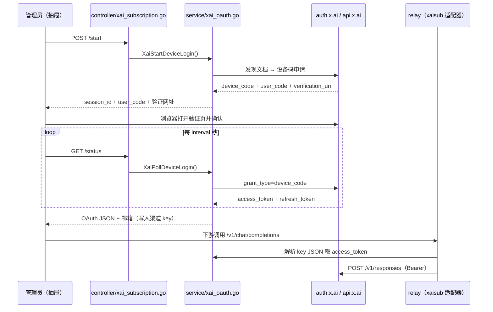

# TECH.md — xAI 订阅授权转 API

用户可见行为以 [PRODUCT.md](./PRODUCT.md) 为准。本文记录实现方案、边界与验证。

## 上下文

### 现状（已核实的代码事实）

- **48 号 xAI 渠道只认 API Key**：`relay/channel/xai/adaptor.go` 的 `SetupRequestHeader` 直接把
  `info.ApiKey` 当 Bearer 发出；`GetRequestURL` 用 `info.ChannelBaseUrl + info.RequestURLPath`；
  `Init` 已按 `RelayModeResponses` 挂上 `xaiResponsesToolUsage`——**Responses 路由本身已通**，
  缺的只是令牌来源。
- **订阅授权在项目内的完整先例是 57 号 codex**：OAuth 会话 JSON 直接存进渠道 key
  （`relay/channel/codex/oauth_key.go`）；`controller/channel.go:645` 校验该 JSON 必含
  `access_token` / `account_id`；`service/codex_oauth.go` 负责用刷新令牌换新；
  `service/codex_credential_refresh_task.go` 每 10 分钟扫一遍（24 小时阈值、批量 200、
  只扫启用/自动禁用态），`main.go:132` 启动；`controller/channel.go:668` 暴露手动刷新端点。
  codex 的录入方式是**管理员手工粘贴 JSON**，项目内没有设备码登录界面。
- **渠道 key 原文直达适配器**：`middleware/distributor.go:683` 把渠道 key 写进 gin context，
  `relay/common/relay_info.go:290` 读成 `info.ApiKey`——所以 OAuth JSON 可以原样存进 key 字段，
  由适配器自己解析，无需改 relay 主链路。
- **适配器分发链**：`common/api_type.go:5 ChannelType2APIType`（渠道类型 → API 类型）→
  `relay/relay_adaptor.go:50 GetAdaptor`（API 类型 → 适配器实例）。新增渠道类型必须在这两处登记。
- **渠道测试对 codex 有两处特判**：`controller/channel-test.go:50`（端点规范化为 Responses）与
  `:670`（自动测试走流式）。订阅类渠道是 Responses-only，需要同样处理。
- **未定价模型会被拒**：调用时模型没有价格配置会直接以渠道错误收场
  （"has not been priced by the administrator yet"）。因此 PRODUCT 第 29 条的「默认定价 0」
  必须落实成**真的把价格写进去**，不能只写在文档里。
- 前端渠道类型登记在 `web/src/features/channels/constants.ts`：`CHANNEL_TYPES`（标签）、
  `CHANNEL_PROVIDER_PRESENTATION`（描述）、`CHANNEL_TYPE_DISPLAY_ORDER`（排序）、
  `TYPE_TO_KEY_PROMPT`（密钥提示）、`FIELD_PASSTHROUGH_TYPES` / `OPENAI_FIELD_PASSTHROUGH_TYPES`
  （字段直通集合，57 号在内）。密钥录入表单在
  `web/src/features/channels/components/drawers/channel-mutate-drawer.tsx`。
- 参照实现（本机可读）：Mika 的 `core/oauth/XaiAuth.kt`（发现文档校验、设备码、身份读取）、
  `DeviceCode.kt`（RFC 8628 客户端与轮询）、`AccountSession.kt`（单飞刷新、防覆盖写回）。

### Fork 合并友好性（本设计的一级约束）

本仓库是上游的 fork、刚合并过 main。因此：新逻辑全部放新文件 / 新包；对既有文件的改动压缩为
**纯追加式的少量 case / 一行**，不加新类型进既有结构体、不改既有函数签名，把合并冲突面降到最小。

## 建议的更改

### A. 新渠道类型与 API 类型（4 处、每处 1-2 行）

- `constant/channel.go`：`ChannelTypeXaiSubscription = 64`（置于 `ChannelTypeDummy` 之前），
  名字表加 `"xAI Subscription (Grok)"`。
- `constant/api_type.go`：`APITypeXaiSubscription`（同样置于 Dummy 前）。
- `common/api_type.go`：`ChannelType2APIType` 加一个 case；`SupportsResponsesCompact` 放行该类型。
- `relay/common/relay_info.go`：`streamSupportedChannels` 加一行（与 48 号 xAI 同命运）。

### B. 新适配器包 `relay/channel/xaisub/`（新包，两个方法）

```go
type Adaptor struct {
    xai.Adaptor            // 嵌入：模型相关转换（grok 搜索参数、reasoning 档位）全部复用
}

func (a *Adaptor) GetRequestURL(info *relaycommon.RelayInfo) (string, error)
func (a *Adaptor) SetupRequestHeader(c *gin.Context, req *http.Header, info *relaycommon.RelayInfo) error
```

- `GetRequestURL`：固定根 `https://api.x.ai/v1`，按 `info.RelayMode` 拼 `/responses`
  （与 `relay/channel/codex/adaptor.go:139` 同构；本类型只服务 Responses 一族，其余模式明确报错）。
- `SetupRequestHeader`：`ParseXaiOAuthKey(info.ApiKey)` → 取 `access_token` 设 Bearer；
  解析失败返回「密钥不是有效的 xAI 订阅凭证」类错误，**不**把 JSON 原文发出去。
- **为什么嵌入而不是复制**：48 号渠道的模型处理（搜索参数、reasoning）与订阅渠道完全一致，
  嵌入让这些改进自动惠及订阅渠道；上游若大改 `xai.Adaptor` 签名，编译期立刻暴露，不会静默漂移。
  这与「新增独立渠道类型」的决策不矛盾——独立的是**类型与计费口径**，不是复制一份转换逻辑。

### C. `service/xai_oauth.go`（新文件，设备码全流程）

```go
type XaiOAuthKey struct {
    AccessToken  string `json:"access_token"`
    RefreshToken string `json:"refresh_token,omitempty"`
    IDToken      string `json:"id_token,omitempty"`
    Email        string `json:"email,omitempty"`
    Scopes       []string `json:"scopes,omitempty"`
    Issuer       string `json:"issuer,omitempty"`
    TokenURL     string `json:"token_url,omitempty"`
    ExpiresAt    string `json:"expires_at,omitempty"`   // RFC3339
    LastRefresh  string `json:"last_refresh,omitempty"`
}

func XaiDiscover() (*XaiEndpoints, error)                    // 发现文档 + 白名单校验
func XaiStartDeviceLogin() (*XaiLoginSession, error)         // 要设备码
func XaiPollDeviceLogin(id string) (XaiPollResult, error)    // 轮询换令牌
func XaiCancelDeviceLogin(id string)
func XaiRefreshToken(ctx context.Context, refreshToken string) (*XaiOAuthKey, error)
```

- 常量：`xaiOAuthClientID = "b1a00492-073a-47ea-816f-4c329264a828"`（grok-cli 公开入口，
  与 Mika 同一个）、`xaiIssuer = "https://auth.x.ai"`、`xaiAPIBase = "https://api.x.ai/v1"`、
  scope `openid profile email offline_access grok-cli:access api:access`。
- **主机白名单**（对应 PRODUCT 第 34 条）：独立小函数 `xaiAllowedURL(raw string, hosts …) bool`——
  必须 https、主机在名单内、不允许 URL 带用户信息段；发现文档的 `issuer` 必须严格等于
  `https://auth.x.ai`，device/token/userinfo 端点主机必须在 `auth.x.ai`。任一不符返回
  `ErrXaiIssuer`，请求不发出。验证页主机允许 `auth.x.ai` / `accounts.x.ai`，否则回落固定官方页
  `https://accounts.x.ai/oauth2/device`。
- **登录态存放**：进程内 `sync.Mutex + map[string]*loginSession`（device_code、user_code、
  verification_uri、expires_at、interval、结果 channel）。界面轮询拿状态，满足 PRODUCT 第 10 条
  （刷新页面不丢进度）；进程重启即丢，对应 PRODUCT 第 15 条。
- **轮询语义**照抄 Mika：`authorization_pending` 按 interval 等、`slow_down` 间隔 +5s、
  `access_denied` / `expired_token` 终局、网络失败连续 3 次才判失败。
- **订阅门槛**（PRODUCT 第 12 条）：拿到的 scope 必须含 `grok-cli:access` 或 `api:access`，
  否则归因为「账号没有可用订阅」。
- **身份**：优先 userinfo 端点取邮箱；失败解 ID 令牌中段（不验签，仅显示，对应 PRODUCT 第 3 条）。
- **刷新**：识别终局错误码集合（`invalid_grant`、`invalid_refresh_token`、`refresh_token_expired`
  等）→ 返回可判定的 `ErrXaiRefreshTerminal`，供上层把渠道标记为登录失效（PRODUCT 第 21 条）。

### D. 凭证刷新任务（镜像 codex，两个新文件 + 一行）

- `service/xai_credential_refresh.go`：`RefreshXaiChannelCredential(ctx, channelID)`——读渠道 key
  解析 JSON → 刷新 → 写回 key → `model.InitChannelCache()`；缺 `refresh_token` 时返回可判定错误
  （对应 PRODUCT 第 5 条的「无法自动续期」提示）。
- `service/xai_credential_refresh_task.go`：10 分钟 tick、24 小时阈值、批量 200、只扫启用/自动禁用态、
  跳过多密钥渠道；终局失败只记 warn（**日志不含令牌**），不写回、不清 key——旧令牌继续用到失效，
  由请求路径报「登录失效」。
- `main.go` 在 `StartCodexCredentialAutoRefreshTask()` 旁加一行启动。

### E. Controller 层（一个新文件 + 三处小改）

- **新文件 `controller/xai_subscription.go`**（不搅进 `channel.go` 家族）：
  - `POST /api/channel/xai_subscription/start` — 开始登录，返回 `session_id` + `user_code` +
    `verification_uri` + `expires_in`（**不含 device_code**）。
  - `GET /api/channel/xai_subscription/status?session_id=` — 界面轮询：等待中（带剩余秒数）/
    成功（返回 OAuth JSON 与邮箱）/ 失败（类别 + 错误码）。
  - `POST /api/channel/xai_subscription/cancel?session_id=`。
  - `POST /api/channel/{id}/xai_subscription/refresh` — 手动刷新凭证，镜像
    `controller/channel.go:668` 的 codex 刷新端点。
  - 全部管理员鉴权；响应里不出现令牌；错误只回类别与错误码。
- `controller/channel.go` 校验分支加一个 case：新类型的 key 必须是 JSON 且含 `access_token`；
  缺 `refresh_token` 不阻断保存（PRODUCT 第 5 条）。
- `controller/channel-test.go:50` 与 `:670` 的 codex 特判**改为按类型集合判断**
  （`isResponsesOnlyChannelType`），把 codex 与新类型一起纳入，避免散着加 case。
- **定价落实**（PRODUCT 第 29 条）：登录成功、模型列表拉回后，把该批模型以 0 倍率补进定价配置
  （`OptionMap["ModelRatio"]` 一族，参照 `controller/model_pricing_config.go` 的写法），
  **已存在非零价格的不覆盖**（管理员手工调过价的要尊重）。否则未定价模型一调用就被拒，
  「免费放行」落空。

### F. 前端

- `constants.ts`：`CHANNEL_TYPES`、`CHANNEL_PROVIDER_PRESENTATION`（描述）、
  `CHANNEL_TYPE_DISPLAY_ORDER`、`TYPE_TO_KEY_PROMPT`、两个 passthrough 集合各加一行（57 号在列，
  新类型同样需要字段直通）。
- `channel-mutate-drawer.tsx`：选中新类型时，密钥区替换为三块——「登录 xAI 账号」主按钮；
  登录中面板（短码大号等宽、验证网址、倒计时、「复制短码并打开验证页」、取消）；
  「手动粘贴 OAuth JSON」折叠后备入口。轮询 status 接口（2 秒），成功后把返回的 JSON 写进表单
  key 字段并触发拉取模型。
- 风险说明文案（黄色警示区）按 PRODUCT 第 6 条前置。
- i18n：`web/src/i18n/locales/` 七种语言补齐；**不要跑 `bun run format`**（会重写全仓文件）。

## 端到端流程



## 测试和验证

编号对应 [PRODUCT.md](./PRODUCT.md) 的行为不变量。

### 后端

1. **白名单与发现文档（第 34、12 条）**——`service/xai_oauth_test.go` 表驱动：issuer 不符、
   端点主机不在 `auth.x.ai`、http  scheme、URL 带用户信息段，四种都必须在发请求前被拒
   （用 `httptest` 假服务端，断言**没有请求到达**）；验证页主机不在名单时回落固定官方页。
2. **设备码状态机（第 7-9、12-15 条）**——同一文件内假服务端驱动：pending → slow_down →
   tokens 的轮询序列；拒绝、过期、超时、网络连续失败三类终局；scope 缺订阅权限时归因为
   「没有可用订阅」；取消后会话即失效；重启（清空 map）后会话消失。
3. **续期与失效（第 20-24 条）**——`service/xai_credential_refresh_test.go`：正常续期写回 key；
   终局错误码不写回且返回可判定错误；缺 refresh_token 不续期；临时网络错误不标记失效。
4. **适配器（第 16-19 条）**——`relay/channel/xaisub/adaptor_test.go`：`GetRequestURL` 固定根与
   `/responses` 路径、非 Responses 模式报错；`SetupRequestHeader` 从 JSON 取令牌、JSON 畸形时报错
   且不泄露原文；嵌入的模型转换（grok 搜索参数）行为与 48 号一致。
5. **渠道准入（第 4、5、24 条）**——`controller` 层：key 非 JSON / 缺 access_token 被拒；
   缺 refresh_token 可存但返回警告标记；失效令牌保存被拒。
6. **渠道测试（第 18 条）**——`controller/channel-test` 既有用例扩展：新类型规范化为 Responses
   端点且走流式。
7. **定价落实（第 29 条）**——登录成功后该渠道模型价格为 0；已存在非零价格不被覆盖。
8. **三库影响**：不新增表、不加迁移；只更新渠道 key 与定价 option。涉及渠道表与 option 表的用例
   按项目三库验证矩阵跑。

### 前端

9. **登录面板（第 7-14 条）**——`channel-mutate-drawer` 的组件测试（假 `fetch` 驱动 status 轮询）：
   短码与验证网址渲染、倒计时、复制并打开、取消、成功后才填 key、失败分类文案、刷新挂载后恢复
   登录中状态。
10. **密钥区形态（第 3-5 条）**——新类型渲染登录按钮而非自由文本框；手工粘贴入口的 JSON 校验与
    「无法自动续期」提示。
11. `bun run typecheck`、涉及文件 `oxlint`、`bun run test`（channels 用例）；
    `bun run i18n:sync` 后 `git diff --stat` 只有预期文件。

### 手动验证

12. 本地起前后端，管理员添加「xAI 订阅」渠道：走完设备码登录（真实 Grok 订阅），确认模型列表
    自动拉回、价格为 0、下游用 `/v1/chat/completions` 与 `/v1/responses` 各调一次成功；
    查看用量日志有记录且不扣配额；人为改坏 refresh_token 触发终局拒绝，确认渠道显示登录失效且
    错误文案可读；退出登录后渠道保留、请求报未登录；刷新页面确认登录进度不丢。

## 风险与缓解

1. **xAI 限制这种用法**：复用 grok-cli 公开 client_id，账号有被限制风险（PRODUCT 第 6 条已前置告知）。
   缓解：登录前强制展示风险说明；不在代码里隐瞒 client_id 来源。
2. **订阅档位调不通**：scope 校验 + 403 归因（PRODUCT 第 12、32 条）把失败挡在登录期与首次调用，
   缓解「登录成功却不能用」的困惑。
3. **未定价导致免费放行落空**：登录成功后端自动补 0 价且不覆盖人工调价（E 节），并有测试 7 守着。
4. **令牌外泄**：令牌只经进程内 map 与渠道 key 流转；status 响应不含 device_code 与令牌；
   日志只记类别与错误码（D 节）；适配器解析失败不原文回显。
5. **单账号速率上限**：订阅渠道撞 429 是预期行为（PRODUCT 第 31 条只要求错误可读），
   不做多账号轮换（意图非目标）。
6. **fork 合并冲突**：既有文件仅 A/D/E 节的少量追加式改动，新逻辑全在新文件新包。

## 后续工作

- 多订阅账号轮换 / 按渠道权重分流：本期不做（意图非目标）。
- xAI 的图片、视频等其他端点接入订阅渠道：本期明确不支持（PRODUCT 第 19 条）。
- 登录态持久化（跨重启恢复进行中的登录）：本期不做，进程重启即丢（PRODUCT 第 15 条）。
